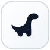

<div align="center">
  

  <h1>Interactive Desktop Portfolio</h1>

  <p>A windowed, desktop-style web portfolio, engineered with React, Vite, Tailwind CSS, Zustand, and GSAP.</p>

  <p>
    <a href="https://vikasaurous.github.io/portfolio/">
      
    </a>
    
    
    
    
  </p>

  <p>
    <a href="https://vikasaurous.github.io/portfolio/"><strong>Explore Live Portfolio</strong></a> ·
    <a href="#highlights"><strong>Features</strong></a> ·
    <a href="#architecture"><strong>Architecture</strong></a> ·
    <a href="#running-locally"><strong>Run Locally</strong></a>
  </p>
</div>

---

## Overview

Instead of a conventional linear scroll page, this repository implements a self-contained browser desktop environment built around a shared window manager, centralized state stores, and lazy-loaded applications. Visitors can drag desktop folders, stack and resize translucent glass windows, query developer info through a working Terminal, search everything via Quick Search, customize themes and wallpapers, or seamlessly use the adaptive mobile layout on touch screens.

---

## Highlights

| Area | Capabilities |
| :--- | :--- |
| **Window Manager** | Open, close, minimize, maximize, focus z-index stacking, titlebar dragging bounded below the top bar, 8-way edge/corner resizing with a live dimension badge, and viewport clamping. |
| **Desktop & App Dock** | Variable-weight interactive typography on hover, draggable desktop folders with GSAP `Draggable`, and a proximity-scaled bottom App Dock with open-state indicators and chunk prefetching. |
| **Built-In Applications** | File Explorer with persistent grid drag-and-drop, In-App Web Browser, interactive Terminal with command parser, PDF Resume Viewer (`react-pdf`), Contact sheet, and Text/Image viewers. |
| **Live Desktop Widgets** | Draggable right-hand widget rails featuring a Quick Profile Card (one-click email copy & CV download), **Currently Shipping** repository feed, and a live 12-week GitHub commit matrix. |
| **Quick Search** | Fuzzy search modal indexing apps, documents, social links, and explorer items with recent search history and full keyboard navigation. |
| **Adaptive Mobile Shell** | Dedicated touch-first mobile workspace (`MobileOS` + slide-up window sheets) with compact profile/GitHub widgets, mobile file explorer, quick-command terminal chips, and Control Center. |
| **Control Center & Themes** | `Light`, `Dark`, and `System` theme synchronization, desktop widget visibility toggle, preset wallpapers, and session-only local custom background uploads (`JPEG`, `PNG`, `WebP`, `AVIF` up to 10 MB). |
| **Liquid Glass & Motion** | Frosted layered surfaces (`backdrop-filter` tokens), synchronous pre-paint intro blur reveal (`sessionStorage` gated), and `prefers-reduced-motion` support across animations. |

---

## Built-In Applications

- **Portfolio File Explorer (`windows/Finder.jsx`)**: Represents portfolio directories and files as an interactive snap-grid workspace with persistent per-folder item coordinates stored via Zustand.
- **Terminal (`windows/Terminal/`)**: Supports command history (`ArrowUp` / `ArrowDown`), `Tab` autocomplete, `Ctrl+C`, `Ctrl+L`, `Esc`, and portfolio commands (`help`, `whoami`, `about`, `skills`, `projects`, `experience`, `education`, `ls`, `cat <file>`, `neofetch`, `theme`, `resume`, `github`, `linkedin`, `contact`, `sudo hire-vikas`, `clear`).
- **Web Browser (`windows/Safari/`)**: Tabbed history navigation, dynamic Favorites and project cards Start Page, animated progress bar, non-embeddable host detection with external fallback, and keyboard shortcuts (`Cmd/Ctrl+L` address bar, `Cmd/Ctrl+R` reload, `Alt+Left`/`Alt+Right` history, `Esc` stop).
- **Resume Viewer (`windows/Resume.jsx`)**: Renders the bundled PDF interactively with selectable text, annotation links, responsive `ResizeObserver` page scaling, and one-click download.
- **Quick Search (`components/Spotlight.jsx`)**: Ranks apps, documents, links, and project entries via fuzzy match scoring with `ArrowUp`/`ArrowDown` selection, `Tab` query completion, `Enter` launch, and `Esc` dismiss.

---

## Tech Stack

| Technology | Role |
| :--- | :--- |
| **React 19** | Component architecture and lazy-loaded application windows |
| **Vite 7** | Development server, path aliases, and code-split production builds |
| **Tailwind CSS v4** | Design tokens, responsive styling, and dark/light glass surfaces |
| **Zustand + Immer** | Window lifecycle, active directories, browser tabs, theme, wallpapers, and widget positions |
| **GSAP (`gsap` + `@gsap/react`)** | Intro blur reveal, desktop/window dragging, maximize geometry tweening, and Dock hover physics |
| **React PDF (`pdfjs-dist`)** | Client-side PDF resume rendering |
| **Lucide React & Day.js** | Vector iconography and real-time status bar clock / relative timestamps |

---

## Architecture

The codebase separates global desktop orchestration from individual app views:

```text
src/
├── components/
│   ├── ChangeBackground/   # Wallpaper picker & client-side image upload sheet
│   ├── DesktopWidgets/     # Draggable profile, Currently Shipping, and GitHub grid rails
│   ├── MobileOS/           # Touch-first mobile workspace & slide-up app sheets
│   ├── Dock.jsx            # Bottom launcher bar with proximity hover magnification
│   ├── Home.jsx            # Draggable desktop project folders
│   ├── LiquidGlassReveal.jsx
│   ├── Navbar.jsx          # Top bar: Sauropod BrandMark, About card, Search, Control Center
│   ├── Spotlight.jsx       # Global fuzzy Quick Search overlay
│   └── Welcome.jsx         # Interactive variable-weight hero typography
├── constants/              # App registry, navigation metadata, and virtual directory tree
├── hoc/
│   └── WindowWrapper.jsx   # Shared drag, 8-way resize, focus, maximize/minimize shell
├── hooks/                  # Mobile breakpoint & GitHub activity fetching hooks
├── store/                  # Zustand stores (window, location, finder, safari, theme, wallpaper, widgets)
├── utils/                  # Fuzzy search index & GitHub pulse parser/cache
└── windows/                # Lazy-loaded apps (Explorer, Terminal, Browser, Resume, Contact, Viewers)
```

**Design principle:** [WindowWrapper.jsx](./src/hoc/WindowWrapper.jsx) owns all window chrome interactions (focus stacking, drag bounds, resizing, maximize animations, and viewport clamping), allowing every app inside `src/windows/` to stay focused on content and reuse body views seamlessly inside mobile sheets.

---

## Running Locally

### Prerequisites

- **Node.js 18+**
- **npm**

### Setup

```sh
git clone https://github.com/vikasaurous/portfolio.git
cd portfolio
npm install
npm run dev
```

Open the local URL printed by Vite (typically `http://localhost:5173/portfolio/`).

### Available Scripts

| Command | Description |
| :--- | :--- |
| `npm run dev` | Start the Vite development server with HMR |
| `npm run lint` | Run ESLint across the repository |
| `npm run build` | Generate the production bundle in `dist/` |
| `npm run preview` | Preview the built production bundle locally |
| `npm run deploy` | Publish `dist/` to GitHub Pages via `gh-pages` |

---

## Author

**Vikas Yadav** (`@vikasaurous`)

- GitHub: [github.com/vikasaurous](https://github.com/vikasaurous)
- LinkedIn: [linkedin.com/in/connectvikasyadav](https://www.linkedin.com/in/connectvikasyadav/)
- Live Portfolio: [vikasaurous.github.io/portfolio](https://vikasaurous.github.io/portfolio/)
